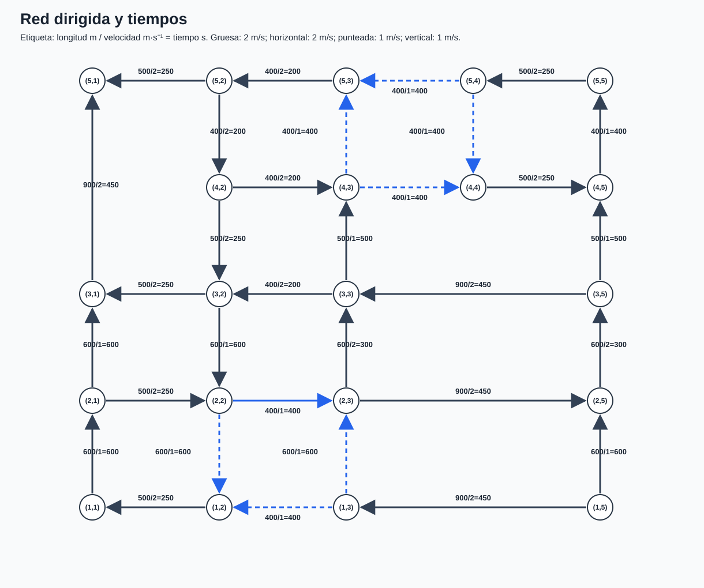
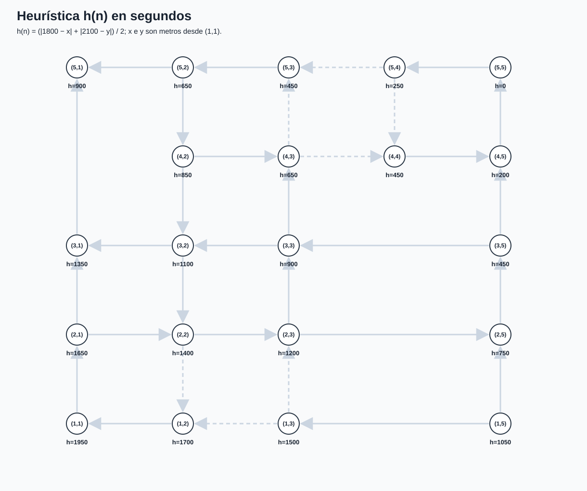
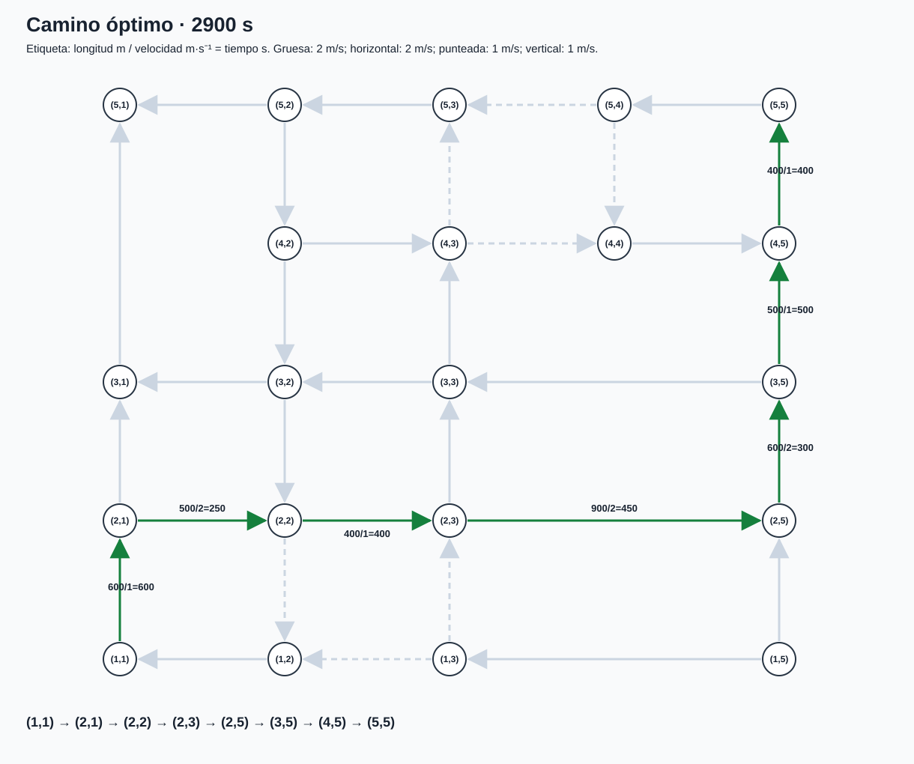

# Ejercicio IDA*: de la red del enunciado a la ruta más rápida

🟢 El enunciado pide ir de **`(1,1)` a `(5,5)`**, con identificadores `(fila,columna)`. Todas las calles son dirigidas. Las distancias están en metros y las velocidades son: trazo grueso `2 m/s`, punteado `1 m/s`, horizontal simple `2 m/s` y vertical simple `1 m/s`. Se pide una heurística admisible del tiempo y la ejecución de IDA*. ([enunciadoIDA.png](../enunciadoIDA.png))

🟡 La solución calculada y verificada es **2900 s = 48 min 20 s**. El recorrido es `(1,1)→(2,1)→(2,2)→(2,3)→(2,5)→(3,5)→(4,5)→(5,5)`. Abajo se muestra cómo se obtiene y por qué ninguna ruta más barata queda sin examinar.

## 1. Reconstrucción de la red

🟢 En el esquema, las separaciones de izquierda a derecha son `500, 400, 400, 500 m`. De abajo arriba son `600, 600, 500, 400 m`. Por tanto la esquina `(1,1)` está en `(x,y)=(0,0)` y `(5,5)` en `(1800,2100)` metros si elegimos ese origen geométrico. Los pares `(fila,columna)` **siguen empezando en 1**. ([enunciadoIDA.png](../enunciadoIDA.png))

🟡 Una flecha se representa como un arco dirigido. Solo tomo como nodos los cruces del dibujo: por ejemplo, en la fila 2 la calle gruesa va de `(2,3)` a `(2,5)` sin cruce en `(2,4)`. Su longitud es `400+500=900 m` y su coste es `900/2=450 s`. Del mismo modo, `(3,1)→(5,1)` recorre `500+400=900 m` sin cruce en `(4,1)`. Las direcciones y los 32 arcos quedan en la figura y tabla siguientes.

🟡 En cada etiqueta del diagrama, `L/v=t` significa metros / metros por segundo = segundos. Puedes inspeccionar las cifras de **todas** las calles en [tabla-calles.md](tabla-calles.md). Las velocidades marcadas en el borrador coinciden con el enunciado; no se usa una velocidad única para toda la red.

## 2. Heurística admisible

🟡 Defino `x_c` como distancia horizontal acumulada desde la columna 1 e `y_r` como distancia vertical acumulada desde la fila 1:

| Columna `c` | 1 | 2 | 3 | 4 | 5 |
| --- | ---: | ---: | ---: | ---: | ---: |
| `x_c` (m) | 0 | 500 | 900 | 1300 | 1800 |

| Fila `r` | 1 | 2 | 3 | 4 | 5 |
| --- | ---: | ---: | ---: | ---: | ---: |
| `y_r` (m) | 0 | 600 | 1200 | 1700 | 2100 |

🟡 Desde un cruce `(r,c)` queda al menos la distancia Manhattan `|1800−x_c|+|2100−y_r|` metros hasta el objetivo. Ninguna calle permite avanzar a más de `2 m/s`. Por tanto:

`h(r,c) = (|1800−x_c| + |2100−y_r|) / 2  segundos`.

🟡 La justificación no depende de que todas las flechas apunten hacia el objetivo. Cualquier desvío solo puede aumentar la distancia recorrida respecto al desplazamiento horizontal más vertical necesario. En cada tramo de longitud `L` y velocidad `v≤2`, el tiempo es `L/v≥L/2`. Sumando tramos, el tiempo real restante es al menos `distancia Manhattan/2`, luego **`h≤h*`**. Además, para cualquier arco `n→n'`, la desigualdad triangular da `h(n)≤L/2+h(n')≤L/v+h(n')`; por tanto `h` también es consistente. Esta es una aplicación de la definición del PDF, con unidades de **segundos**. (Contraste con Tema 1.pdf pp.13,16–17)

🟡 En `(1,1)`, `h=(1800+2100)/2=1950 s`; en `(5,5)`, `h=0`. El diagrama coloca el valor en cada cruce real, y [tabla-heuristica.md](tabla-heuristica.md) contiene las coordenadas y todos los valores.

## 3. Tus tres fotos, en el orden indicado

🟢 **ejercicioIDA1.jpeg.** Calculas `h(0,0)=3900/2=1950` y tomas la primera «poda» `1950`. Anotas el orden **arriba, derecha, abajo, izquierda**. Luego calculas `g=600`, `h=1650`, `f=2250` para el primer movimiento hacia arriba; se poda con umbral 1950 y la cota pasa a 2250. En la segunda pasada aparecen `g=1200`, `h=1350`, `f=2550` por dos movimientos verticales, y `g=850`, `h=1400`, `f=2250` tras avanzar a la derecha. Estos cálculos son correctos. ([ejercicioIDA1.jpeg](../ejercicioIDA1.jpeg))

🟡 **Ajuste de notación:** tu `(0,0)` identifica correctamente el origen **en metros**, pero no es el nombre del nodo del enunciado. Aquí lo nombro `(1,1)`. Los valores numéricos de la heurística se conservan. La flecha «derecha» desde `(2,1)` recorre `500 m` a `2 m/s`, de ahí `250 s`; la flecha «arriba» desde `(1,1)` recorre `600 m` a `1 m/s`, de ahí `600 s`.

🟢 **ejercicioIDA2.jpeg.** Reanudas con umbral `2450`; en la rama oriental se leen costes de `400`, `300` y `450 s`, y valores `f=2450`. Más adelante aparecen `f=2700` y ramas podadas. La observación «si `h(n)≤h*(n)`, IDA* es admisible» apunta en la dirección correcta. La foto no demuestra una llegada final al objetivo. ([ejercicioIDA2.jpeg](../ejercicioIDA2.jpeg))

🟡 **Laguna a completar:** después de la pasada `2450` no basta repetirla con un incremento arbitrario. Hay que recoger **todos** los `f` que excedieron el umbral y elegir el menor: aparece `2550` en la rama norte de `(2,1)`, así que el siguiente umbral es `2550`; después vienen `2700`, `2850` y `2900`. La afirmación general de admisibilidad requiere precisar costes positivos, ramificación finita, heurística admisible y control de ciclos del camino.

🟢 **ejercicioIDA3.jpeg.** Escribes las velocidades por tipo de calle, el origen geométrico `(0,0)`, el objetivo `(1800,2100)` y `h(x,y)=(1800+2100−x−y)/2`. Eso es correcto para los puntos de la red, todos al suroeste del destino. ([ejercicioIDA3.jpeg](../ejercicioIDA3.jpeg))

🟡 He usado el orden de sucesores **norte, este, sur, oeste** de tu primera foto. Solo se generan direcciones para las que existe una flecha saliente. Dentro de cada búsqueda en profundidad omito estados que ya están en el **camino actual**; eso evita ciclos y no descarta ningún camino simple óptimo, pues todos los costes son positivos. En las fotos hay algunas cifras pálidas que no se distinguen con seguridad, por lo que he recalculado todos los `g`, `h` y `f` desde el enunciado. **No existe un archivo adicional llamado `ejercicioIDAX` en la carpeta proporcionada**; he trabajado con `ejercicioIDA1.jpeg`, `ejercicioIDA2.jpeg` y `ejercicioIDA3.jpeg`.

## 4. Ejecución completa de IDA*

🟡 Inicializo `umbral=h(1,1)=1950`. En cada pasada, un nodo con `f=g+h>umbral` se poda; si `f=umbral`, se puede expandir. Cuando no se encuentra el objetivo, el umbral siguiente es el menor `f` entre las podas de esa pasada. «Expande» significa que se prueban sus sucesores; el objetivo se acepta cuando se alcanza dentro del umbral.

| Pasada | Umbral (s) | Expansiones | Podas por `f>umbral` | Menor `f` podado / resultado |
| ---: | ---: | ---: | ---: | --- |
| 1 | 1950 | 1 | 1 | 2250 |
| 2 | 2250 | 3 | 3 | 2450 |
| 3 | 2450 | 7 | 6 | 2550 |
| 4 | 2550 | 9 | 5 | 2700 |
| 5 | 2700 | 11 | 6 | 2850 |
| 6 | 2850 | 12 | 6 | 2900 |
| 7 | 2900 | 15 | 3 | objetivo `(5,5)` |

🟡 Estas cuentas se refieren a **ocurrencias del árbol de búsqueda**, de modo que un mismo estado visitado en dos pasadas cuenta dos veces. En la pasada 7 se detiene la búsqueda al hallar el objetivo; por eso no se recorren hermanos posteriores. Abre la [traza-completa.md](traza-completa.md) para seguir **cada paso**: camino actual, `g`, `h`, `f`, expansión o poda. Los diagramas separados están aquí:

| Umbral | Árbol independiente |
| ---: | --- |
| 1950 s | [ida-umbral-1950.svg](ida-umbral-1950.svg) |
| 2250 s | [ida-umbral-2250.svg](ida-umbral-2250.svg) |
| 2450 s | [ida-umbral-2450.svg](ida-umbral-2450.svg) |
| 2550 s | [ida-umbral-2550.svg](ida-umbral-2550.svg) |
| 2700 s | [ida-umbral-2700.svg](ida-umbral-2700.svg) |
| 2850 s | [ida-umbral-2850.svg](ida-umbral-2850.svg) |
| 2900 s | [ida-umbral-2900.svg](ida-umbral-2900.svg) |

🟡 Dos puntos explican el progreso. Con umbral `2250`, la ruta `(1,1)→(2,1)→(2,2)` tiene `g=850`, `h=1400`, `f=2250`: se expande por **igualdad**. Su sucesor `(2,3)` tiene `g=1250`, `h=1200`, `f=2450`: se poda, pero fija el umbral siguiente. Con umbral `2450`, ya se llega a `(3,5)` por la rama derecha con `g=2000`, `h=450`, `f=2450`; su sucesor `(4,5)` tiene `g=2500`, `h=200`, `f=2700`, así que todavía no se alcanza el objetivo. El menor exceso global en esa pasada es `2550`, procedente de `(3,1)` por la rama norte, aunque la rama visualmente prometedora pida `2700`.

🟡 En la última pasada también se explora una alternativa por `(4,3)→(4,4)→(4,5)`, pero su objetivo tendría `g=f=3100` y queda podado con umbral `2900`. Después, la rama oriental llega a `(5,5)` con `g=f=2900` y se acepta. Los árboles muestran explícitamente esa poda y ese objetivo.

## 5. Coste final y comprobación

| Tramo del camino final | Cálculo | Coste (s) | `g` al llegar | `h` al llegar | `f` |
| --- | --- | ---: | ---: | ---: | ---: |
| Inicio `(1,1)` | — | 0 | 0 | 1950 | 1950 |
| `(1,1)→(2,1)` | `600/1` | 600 | 600 | 1650 | 2250 |
| `(2,1)→(2,2)` | `500/2` | 250 | 850 | 1400 | 2250 |
| `(2,2)→(2,3)` | `400/1` | 400 | 1250 | 1200 | 2450 |
| `(2,3)→(2,5)` | `900/2` | 450 | 1700 | 750 | 2450 |
| `(2,5)→(3,5)` | `600/2` | 300 | 2000 | 450 | 2450 |
| `(3,5)→(4,5)` | `500/1` | 500 | 2500 | 200 | 2700 |
| `(4,5)→(5,5)` | `400/1` | 400 | **2900** | 0 | **2900** |

🟡 La suma es `600+250+400+450+300+500+400=2900 s`. Al cerrar las pasadas con umbrales menores que `2900`, IDA* ya había examinado o podado todas las rutas cuyo límite inferior podía ser menor que ese valor. Dado que `h` nunca sobreestima, ningún camino de coste inferior a `2900` puede quedar oculto detrás de una poda con `f>2900`. Como comprobación independiente sobre los **32 arcos reconstruidos**, Dijkstra también devuelve **2900 s**; el archivo [traza-ida.json](traza-ida.json) conserva los datos y [ida_modelo.py](../ida_modelo.py) permite recalcularlos.
