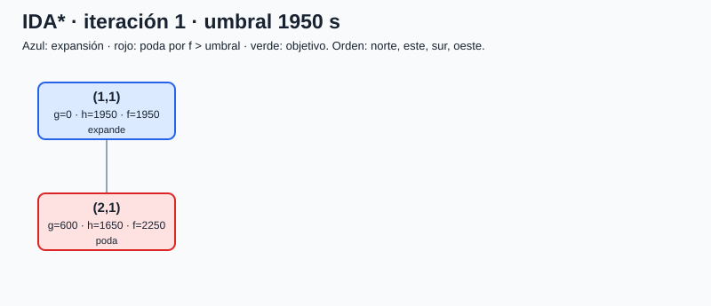
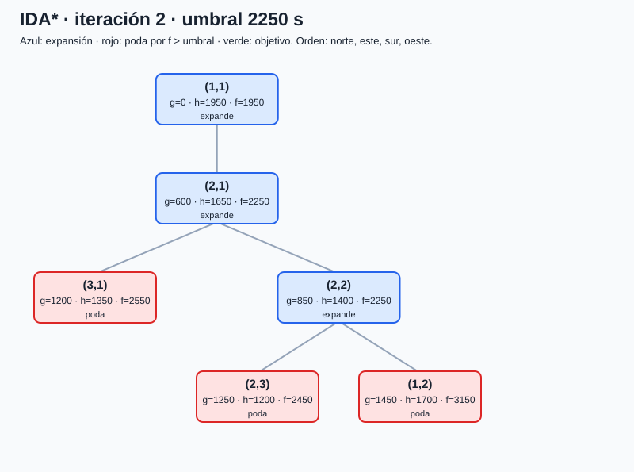
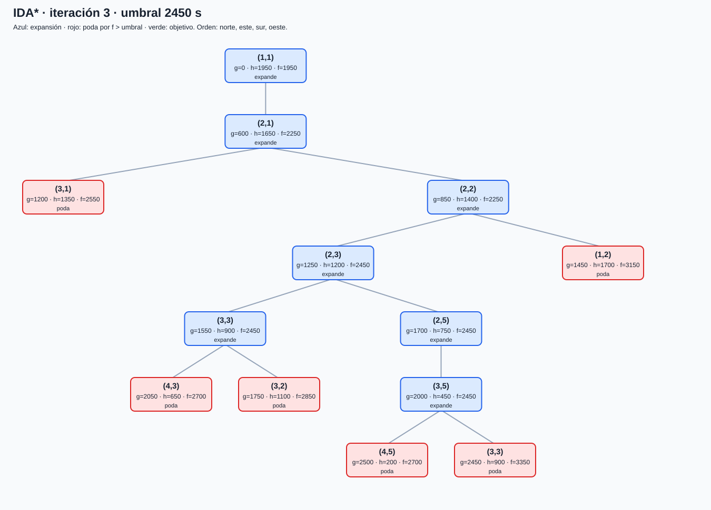
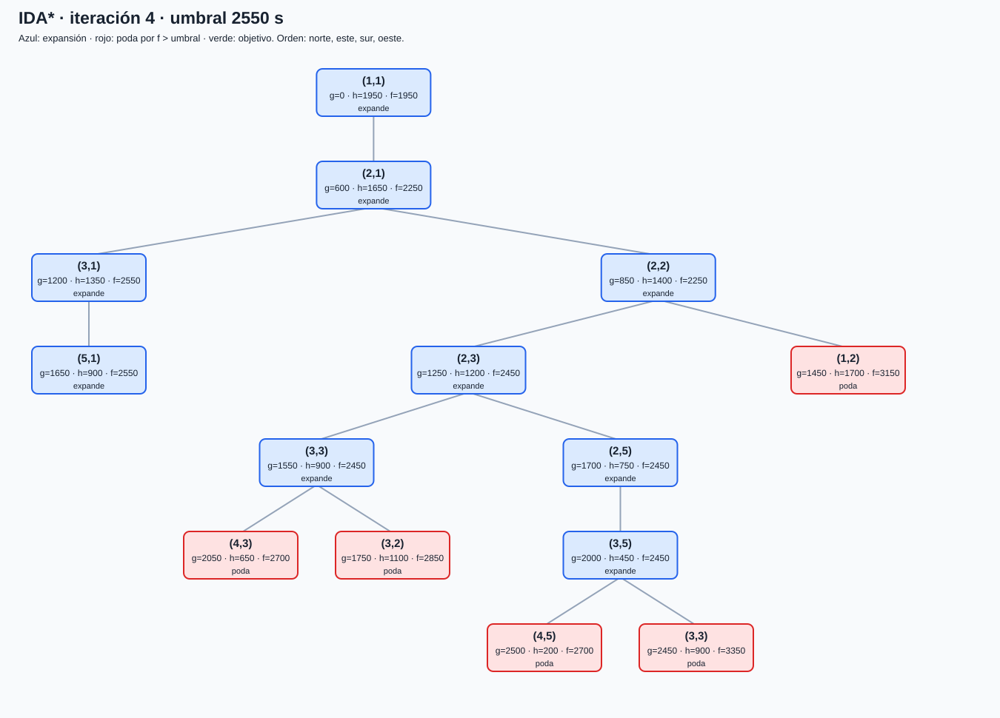
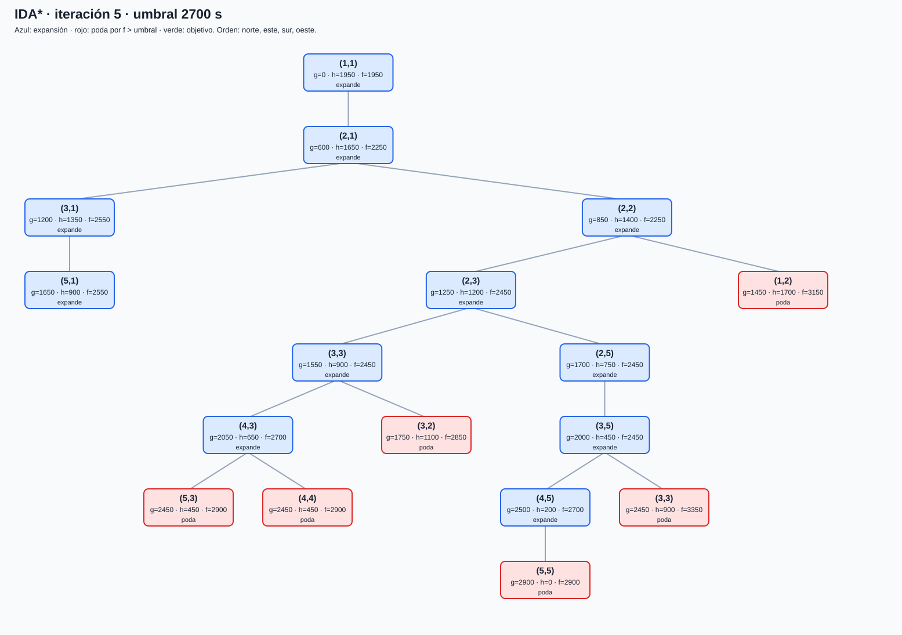
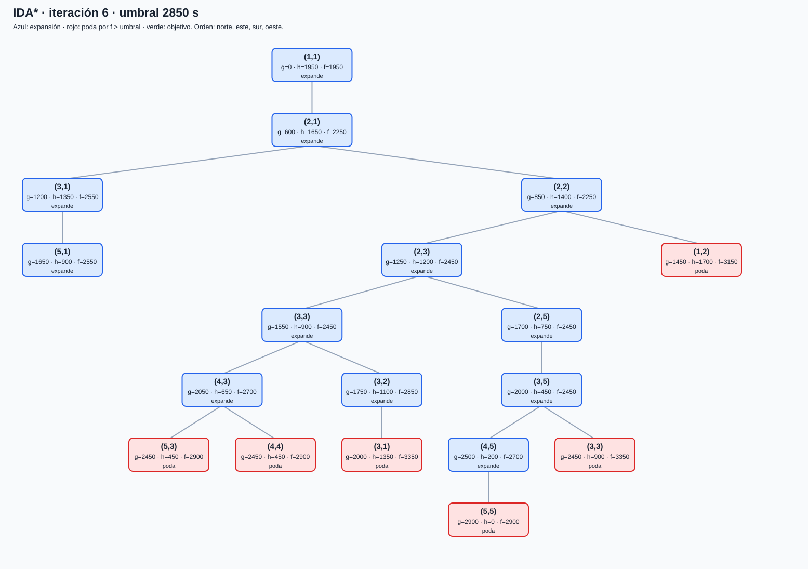
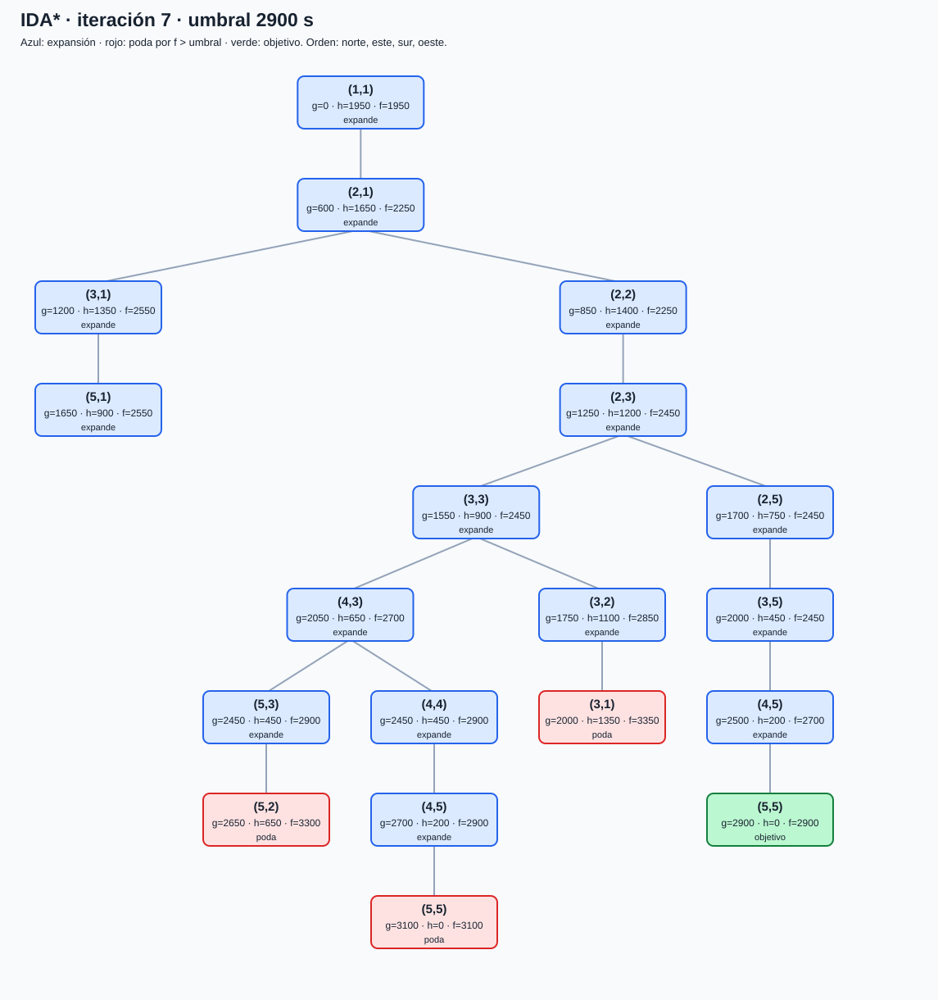

# Traza completa de IDA*

🟡 Calculada a partir de la red del enunciado. En cada fila se muestra el camino **actual**, g, h y f en segundos. Los nodos repetidos en el camino actual se omiten. Se recorren los sucesores en orden norte, este, sur, oeste.

## Iteración 1: umbral 1950 s

| Paso | Camino actual | g | h | f | Resultado |
| ---: | --- | ---: | ---: | ---: | --- |
| 1 | (1,1) | 0 | 1950 | 1950 | expande |
| 2 | (1,1) → (2,1) | 600 | 1650 | 2250 | poda |

Siguiente umbral: **2250** s (mínimo f podado).

## Iteración 2: umbral 2250 s

| Paso | Camino actual | g | h | f | Resultado |
| ---: | --- | ---: | ---: | ---: | --- |
| 1 | (1,1) | 0 | 1950 | 1950 | expande |
| 2 | (1,1) → (2,1) | 600 | 1650 | 2250 | expande |
| 3 | (1,1) → (2,1) → (3,1) | 1200 | 1350 | 2550 | poda |
| 4 | (1,1) → (2,1) → (2,2) | 850 | 1400 | 2250 | expande |
| 5 | (1,1) → (2,1) → (2,2) → (2,3) | 1250 | 1200 | 2450 | poda |
| 6 | (1,1) → (2,1) → (2,2) → (1,2) | 1450 | 1700 | 3150 | poda |

Siguiente umbral: **2450** s (mínimo f podado).

## Iteración 3: umbral 2450 s

| Paso | Camino actual | g | h | f | Resultado |
| ---: | --- | ---: | ---: | ---: | --- |
| 1 | (1,1) | 0 | 1950 | 1950 | expande |
| 2 | (1,1) → (2,1) | 600 | 1650 | 2250 | expande |
| 3 | (1,1) → (2,1) → (3,1) | 1200 | 1350 | 2550 | poda |
| 4 | (1,1) → (2,1) → (2,2) | 850 | 1400 | 2250 | expande |
| 5 | (1,1) → (2,1) → (2,2) → (2,3) | 1250 | 1200 | 2450 | expande |
| 6 | (1,1) → (2,1) → (2,2) → (2,3) → (3,3) | 1550 | 900 | 2450 | expande |
| 7 | (1,1) → (2,1) → (2,2) → (2,3) → (3,3) → (4,3) | 2050 | 650 | 2700 | poda |
| 8 | (1,1) → (2,1) → (2,2) → (2,3) → (3,3) → (3,2) | 1750 | 1100 | 2850 | poda |
| 9 | (1,1) → (2,1) → (2,2) → (2,3) → (2,5) | 1700 | 750 | 2450 | expande |
| 10 | (1,1) → (2,1) → (2,2) → (2,3) → (2,5) → (3,5) | 2000 | 450 | 2450 | expande |
| 11 | (1,1) → (2,1) → (2,2) → (2,3) → (2,5) → (3,5) → (4,5) | 2500 | 200 | 2700 | poda |
| 12 | (1,1) → (2,1) → (2,2) → (2,3) → (2,5) → (3,5) → (3,3) | 2450 | 900 | 3350 | poda |
| 13 | (1,1) → (2,1) → (2,2) → (1,2) | 1450 | 1700 | 3150 | poda |

Siguiente umbral: **2550** s (mínimo f podado).

## Iteración 4: umbral 2550 s

| Paso | Camino actual | g | h | f | Resultado |
| ---: | --- | ---: | ---: | ---: | --- |
| 1 | (1,1) | 0 | 1950 | 1950 | expande |
| 2 | (1,1) → (2,1) | 600 | 1650 | 2250 | expande |
| 3 | (1,1) → (2,1) → (3,1) | 1200 | 1350 | 2550 | expande |
| 4 | (1,1) → (2,1) → (3,1) → (5,1) | 1650 | 900 | 2550 | expande |
| 5 | (1,1) → (2,1) → (2,2) | 850 | 1400 | 2250 | expande |
| 6 | (1,1) → (2,1) → (2,2) → (2,3) | 1250 | 1200 | 2450 | expande |
| 7 | (1,1) → (2,1) → (2,2) → (2,3) → (3,3) | 1550 | 900 | 2450 | expande |
| 8 | (1,1) → (2,1) → (2,2) → (2,3) → (3,3) → (4,3) | 2050 | 650 | 2700 | poda |
| 9 | (1,1) → (2,1) → (2,2) → (2,3) → (3,3) → (3,2) | 1750 | 1100 | 2850 | poda |
| 10 | (1,1) → (2,1) → (2,2) → (2,3) → (2,5) | 1700 | 750 | 2450 | expande |
| 11 | (1,1) → (2,1) → (2,2) → (2,3) → (2,5) → (3,5) | 2000 | 450 | 2450 | expande |
| 12 | (1,1) → (2,1) → (2,2) → (2,3) → (2,5) → (3,5) → (4,5) | 2500 | 200 | 2700 | poda |
| 13 | (1,1) → (2,1) → (2,2) → (2,3) → (2,5) → (3,5) → (3,3) | 2450 | 900 | 3350 | poda |
| 14 | (1,1) → (2,1) → (2,2) → (1,2) | 1450 | 1700 | 3150 | poda |

Siguiente umbral: **2700** s (mínimo f podado).

## Iteración 5: umbral 2700 s

| Paso | Camino actual | g | h | f | Resultado |
| ---: | --- | ---: | ---: | ---: | --- |
| 1 | (1,1) | 0 | 1950 | 1950 | expande |
| 2 | (1,1) → (2,1) | 600 | 1650 | 2250 | expande |
| 3 | (1,1) → (2,1) → (3,1) | 1200 | 1350 | 2550 | expande |
| 4 | (1,1) → (2,1) → (3,1) → (5,1) | 1650 | 900 | 2550 | expande |
| 5 | (1,1) → (2,1) → (2,2) | 850 | 1400 | 2250 | expande |
| 6 | (1,1) → (2,1) → (2,2) → (2,3) | 1250 | 1200 | 2450 | expande |
| 7 | (1,1) → (2,1) → (2,2) → (2,3) → (3,3) | 1550 | 900 | 2450 | expande |
| 8 | (1,1) → (2,1) → (2,2) → (2,3) → (3,3) → (4,3) | 2050 | 650 | 2700 | expande |
| 9 | (1,1) → (2,1) → (2,2) → (2,3) → (3,3) → (4,3) → (5,3) | 2450 | 450 | 2900 | poda |
| 10 | (1,1) → (2,1) → (2,2) → (2,3) → (3,3) → (4,3) → (4,4) | 2450 | 450 | 2900 | poda |
| 11 | (1,1) → (2,1) → (2,2) → (2,3) → (3,3) → (3,2) | 1750 | 1100 | 2850 | poda |
| 12 | (1,1) → (2,1) → (2,2) → (2,3) → (2,5) | 1700 | 750 | 2450 | expande |
| 13 | (1,1) → (2,1) → (2,2) → (2,3) → (2,5) → (3,5) | 2000 | 450 | 2450 | expande |
| 14 | (1,1) → (2,1) → (2,2) → (2,3) → (2,5) → (3,5) → (4,5) | 2500 | 200 | 2700 | expande |
| 15 | (1,1) → (2,1) → (2,2) → (2,3) → (2,5) → (3,5) → (4,5) → (5,5) | 2900 | 0 | 2900 | poda |
| 16 | (1,1) → (2,1) → (2,2) → (2,3) → (2,5) → (3,5) → (3,3) | 2450 | 900 | 3350 | poda |
| 17 | (1,1) → (2,1) → (2,2) → (1,2) | 1450 | 1700 | 3150 | poda |

Siguiente umbral: **2850** s (mínimo f podado).

## Iteración 6: umbral 2850 s

| Paso | Camino actual | g | h | f | Resultado |
| ---: | --- | ---: | ---: | ---: | --- |
| 1 | (1,1) | 0 | 1950 | 1950 | expande |
| 2 | (1,1) → (2,1) | 600 | 1650 | 2250 | expande |
| 3 | (1,1) → (2,1) → (3,1) | 1200 | 1350 | 2550 | expande |
| 4 | (1,1) → (2,1) → (3,1) → (5,1) | 1650 | 900 | 2550 | expande |
| 5 | (1,1) → (2,1) → (2,2) | 850 | 1400 | 2250 | expande |
| 6 | (1,1) → (2,1) → (2,2) → (2,3) | 1250 | 1200 | 2450 | expande |
| 7 | (1,1) → (2,1) → (2,2) → (2,3) → (3,3) | 1550 | 900 | 2450 | expande |
| 8 | (1,1) → (2,1) → (2,2) → (2,3) → (3,3) → (4,3) | 2050 | 650 | 2700 | expande |
| 9 | (1,1) → (2,1) → (2,2) → (2,3) → (3,3) → (4,3) → (5,3) | 2450 | 450 | 2900 | poda |
| 10 | (1,1) → (2,1) → (2,2) → (2,3) → (3,3) → (4,3) → (4,4) | 2450 | 450 | 2900 | poda |
| 11 | (1,1) → (2,1) → (2,2) → (2,3) → (3,3) → (3,2) | 1750 | 1100 | 2850 | expande |
| 12 | (1,1) → (2,1) → (2,2) → (2,3) → (3,3) → (3,2) → (3,1) | 2000 | 1350 | 3350 | poda |
| 13 | (1,1) → (2,1) → (2,2) → (2,3) → (2,5) | 1700 | 750 | 2450 | expande |
| 14 | (1,1) → (2,1) → (2,2) → (2,3) → (2,5) → (3,5) | 2000 | 450 | 2450 | expande |
| 15 | (1,1) → (2,1) → (2,2) → (2,3) → (2,5) → (3,5) → (4,5) | 2500 | 200 | 2700 | expande |
| 16 | (1,1) → (2,1) → (2,2) → (2,3) → (2,5) → (3,5) → (4,5) → (5,5) | 2900 | 0 | 2900 | poda |
| 17 | (1,1) → (2,1) → (2,2) → (2,3) → (2,5) → (3,5) → (3,3) | 2450 | 900 | 3350 | poda |
| 18 | (1,1) → (2,1) → (2,2) → (1,2) | 1450 | 1700 | 3150 | poda |

Siguiente umbral: **2900** s (mínimo f podado).

## Iteración 7: umbral 2900 s

| Paso | Camino actual | g | h | f | Resultado |
| ---: | --- | ---: | ---: | ---: | --- |
| 1 | (1,1) | 0 | 1950 | 1950 | expande |
| 2 | (1,1) → (2,1) | 600 | 1650 | 2250 | expande |
| 3 | (1,1) → (2,1) → (3,1) | 1200 | 1350 | 2550 | expande |
| 4 | (1,1) → (2,1) → (3,1) → (5,1) | 1650 | 900 | 2550 | expande |
| 5 | (1,1) → (2,1) → (2,2) | 850 | 1400 | 2250 | expande |
| 6 | (1,1) → (2,1) → (2,2) → (2,3) | 1250 | 1200 | 2450 | expande |
| 7 | (1,1) → (2,1) → (2,2) → (2,3) → (3,3) | 1550 | 900 | 2450 | expande |
| 8 | (1,1) → (2,1) → (2,2) → (2,3) → (3,3) → (4,3) | 2050 | 650 | 2700 | expande |
| 9 | (1,1) → (2,1) → (2,2) → (2,3) → (3,3) → (4,3) → (5,3) | 2450 | 450 | 2900 | expande |
| 10 | (1,1) → (2,1) → (2,2) → (2,3) → (3,3) → (4,3) → (5,3) → (5,2) | 2650 | 650 | 3300 | poda |
| 11 | (1,1) → (2,1) → (2,2) → (2,3) → (3,3) → (4,3) → (4,4) | 2450 | 450 | 2900 | expande |
| 12 | (1,1) → (2,1) → (2,2) → (2,3) → (3,3) → (4,3) → (4,4) → (4,5) | 2700 | 200 | 2900 | expande |
| 13 | (1,1) → (2,1) → (2,2) → (2,3) → (3,3) → (4,3) → (4,4) → (4,5) → (5,5) | 3100 | 0 | 3100 | poda |
| 14 | (1,1) → (2,1) → (2,2) → (2,3) → (3,3) → (3,2) | 1750 | 1100 | 2850 | expande |
| 15 | (1,1) → (2,1) → (2,2) → (2,3) → (3,3) → (3,2) → (3,1) | 2000 | 1350 | 3350 | poda |
| 16 | (1,1) → (2,1) → (2,2) → (2,3) → (2,5) | 1700 | 750 | 2450 | expande |
| 17 | (1,1) → (2,1) → (2,2) → (2,3) → (2,5) → (3,5) | 2000 | 450 | 2450 | expande |
| 18 | (1,1) → (2,1) → (2,2) → (2,3) → (2,5) → (3,5) → (4,5) | 2500 | 200 | 2700 | expande |
| 19 | (1,1) → (2,1) → (2,2) → (2,3) → (2,5) → (3,5) → (4,5) → (5,5) | 2900 | 0 | 2900 | objetivo |

Siguiente umbral: **no procede; objetivo encontrado** 
